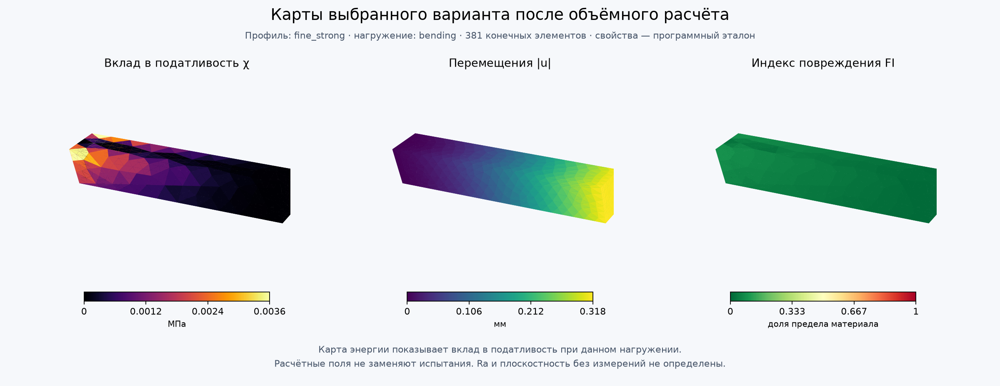

# Численная проверка функционального ядра

Текущие метрики пересчитаны на Windows с установленными определениями STE. Все свойства профилей — `software_fixture`, не результаты печати.

| Модель | Метрика | До | После |
|---|---|---:|---:|
| beam | effective_stiffness_N_per_mm | 6.99356 | 14.1067 |
| beam | compliance_Nmm | 14.2989 | 7.08884 |
| beam | max_displacement_mm | 1.43714 | 0.712451 |
| beam | safety_factor_min | 3.68849 | 7.90708 |

beam: 40 кандидатов, 16 допустимых, нарушений выбранного 0; сходимость: `{"status": "pass", "cases": [{"id": "bending", "compliance_relative_change": 0.0013120353493117304, "displacement_relative_change": 0.001299264897061455, "failure_index_relative_change": 0.0032215854715782533}], "coarse_elements": 324, "fine_elements": 621, "tolerances": {"compliance": 0.05, "displacement": 0.05, "failure_index": 0.1}, "refined_limit_failures": []}`.

| wedge | effective_stiffness_N_per_mm | 16.143 | 32.2861 |
| wedge | compliance_Nmm | 6.19462 | 3.09731 |
| wedge | max_displacement_mm | 0.637411 | 0.318706 |
| wedge | safety_factor_min | 5.70906 | 11.4181 |

wedge: 60 кандидатов, 8 допустимых, нарушений выбранного 0; сходимость: `{"status": "pass", "cases": [{"id": "bending", "compliance_relative_change": 0.0010658720142850784, "displacement_relative_change": 0.0010553550768155943, "failure_index_relative_change": 0.044545120195994735}], "coarse_elements": 381, "fine_elements": 810, "tolerances": {"compliance": 0.05, "displacement": 0.05, "failure_index": 0.1}, "refined_limit_failures": []}`.

## Блоки консоли

Вклад в податливость суммируется; его обратная величина не является независимой жёсткостью блока.

| Блок | C до, Н·мм | C после, Н·мм | Доля энергии после | Мин. запас после |
|---|---:|---:|---:|---:|
| middle_block | 5.73104 | 2.82325 | 39.827% | 10.7295 |
| root_block | 8.26738 | 4.13637 | 58.350% | 7.90708 |
| tip_block | 0.300437 | 0.129218 | 1.823% | 31.3722 |

Независимая балочная формула: относительное отличие 0.812%. Конечный поиск совпал с oracle по проверенному набору; глобальная/физическая оптимальность не доказана.

Нативный STE, LLM, проверки утечек и устойчивости: [актуальный сводный отчёт](ste_runtime_report.md). Ra и плоскостность остаются null; блок не аттестован для производства.

