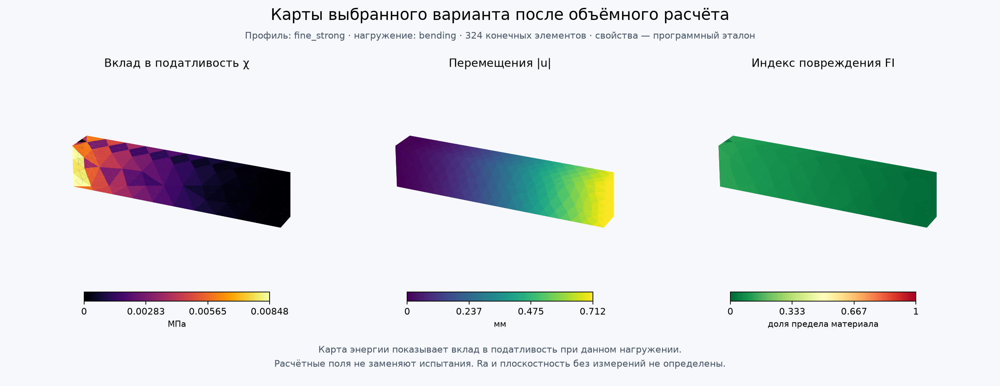

# Проверка функциональной ориентации и параметров

Актуальный main спуллен до 5b34780 перед интеграцией. Отчёт описывает расчётную часть и LLM; физической квалификации отпечатков нет.

## Проверки

- Ядро и интеграция: 134 passed, 0 failed, 1 skipped (старый Uranium). Включены все семь примеров организаторов, Double ML и регрессионные проверки инспектора G-code.
- Живая LLM: 8/8 сценариев; модель dashscope/qwen3.8-flash. Силы, направления и роли совпали с ручной разметкой; отсутствие входов обнаружено. Это малый фиксированный набор, не оценка качества на произвольных запросах.
- Сквозной путь LLM → валидатор → FEA → поиск → компилятор: True.
- Отличие жёсткости консоли от независимой формулы Эйлера–Бернулли: 0.816%. Формула не учитывает поперечный сдвиг и эффект зажима.
- Грамматика Python 3.5: 23 модулей. Реальный Windows runtime не запускался.

## Численные метрики

**Свойства обоих материалов/профилей условные (software_fixture). Улучшения не являются измеренным эффектом стенок, заполнения или высоты слоя.**

| Модель | Показатель | До | После |
|---|---|---:|---:|
| Консоль | Жёсткость, Н/мм | 6.9935 | 14.106 |
| Консоль | Податливость, Н·мм | 14.299 | 7.0891 |
| Консоль | Макс. перемещение, мм | 1.4371 | 0.71247 |
| Консоль | Мин. запас | 3.7228 | 7.8862 |
| Консоль | Средняя ступенчатость, мм | 0.000000 | 0.000000 |
| Клин | Жёсткость, Н/мм | 16.142 | 32.284 |
| Клин | Податливость, Н·мм | 6.195 | 3.0975 |
| Клин | Макс. перемещение, мм | 0.63746 | 0.31873 |
| Клин | Мин. запас | 5.7091 | 11.418 |
| Клин | Средняя ступенчатость, мм | 0.019244 | 0.009622 |

## Локальные блоки консоли

Вклад в податливость суммируется по блокам. Это не отдельная жёсткость блока в Н/мм: она зависит от связей с остальной деталью. Границы блока аппроксимированы принадлежностью FE-центроидов.

| Блок | Вклад C до, Н·мм | После, Н·мм | Доля энергии после | Мин. запас после |
|---|---:|---:|---:|---:|
| root_block | 8.2666 | 4.1366 | 58.35% | 7.886 |
| middle_block | 5.7278 | 2.8213 | 39.80% | 10.73 |
| tip_block | 0.30459 | 0.13126 | 1.85% | 29.03 |

## Качество выбора и сходимость

| Модель | Проверено кандидатов | Допустимых | Нарушений у выбранного | Ошибок настройки STE |
|---|---:|---:|---:|---:|
| beam | 40 | 16 | 0 | 0 |
| wedge | 60 | 8 | 0 | 0 |

- beam: 324 → 620 элементов; ΔC=0.127%, Δu=0.128%, ΔFI=0.121%; статус pass.

- wedge: 383 → 817 элементов; ΔC=0.101%, Δu=0.098%, ΔFI=4.430%; статус pass.

Выбранный результат совпадает с сортировкой всех проверенных допустимых кандидатов. Это проверка реализации конечного поиска, а не доказательство глобального оптимума или производственной оптимальности.

## Что остаётся незавершённым

Задание для модели с доступом к рабочему STE Slicer:
[ste_runtime_handoff.md](ste_runtime_handoff.md). Проверки инспектора G-code
не заменяют применение настроек и слайсинг в установленной программе.

- Ra и фактическая плоскостность: данных нет; в API null. Геометрическая ступенчатость не подменяет эти величины.
- Реальные свойства напечатанного материала при рабочих температуре/среде и испытания детали.
- Исполнение enforcer/blocker в запущенном STE, readback и фактический G-code.
- 5D: кинематика, головка и оправка; пока результат не применяется автоматически.
- Встроенный Windows Python 3.5/Uranium.

**Расчётная часть и LLM проверены; полностью закрытым производственный блок считать нельзя.**

Подробности: [FUNCTIONAL.md](../plugin/FUNCTIONAL.md), [числа](functional_results.json), [LLM](functional_llm_results.json), [тесты](functional_tests.xml).
